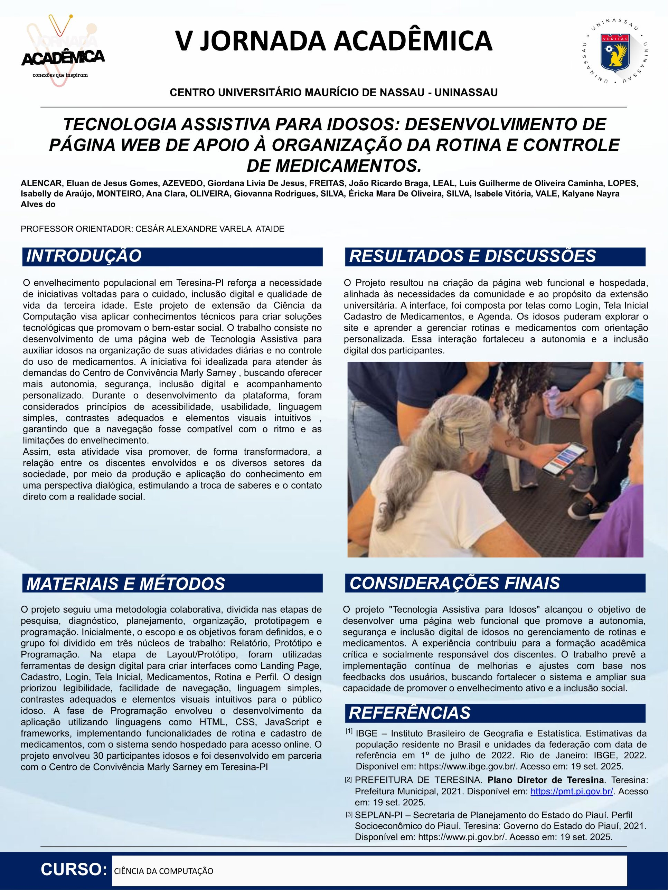

# Vida Plena - Assistente Diário



Aplicativo web de apoio à rotina e ao controle de medicamentos de pessoas idosas. Nasceu do projeto de extensão de Ciência da Computação da UNINASSAU, desenvolvido em parceria com o Centro de Convivência Marly Sarney, em Teresina-PI, e apresentado na V Jornada Acadêmica. Esta é a versão revisada e ampliada por mim (Kalyane).

O banner completo, com a equipe e as referências, está em [`docs/BANNER_Jornada_Academica.pdf`](docs/BANNER_Jornada_Academica.pdf).

## Funcionalidades
- Cadastro e login (simulados; senha salva como hash no navegador)
- **Início:** próximo remédio, resumo do dia, consulta mais próxima, dica do dia e botão de emergência
- **Remédios:** cadastro com dose e horário, marcar como tomado e lembrete na hora (com o app aberto)
- **Consultas:** agendamento com data, hora e local
- **Saúde:** registro de pressão, glicemia, peso e batimentos, com histórico
- **Perfil:** dados pessoais, tipo sanguíneo e contato de emergência (o botão liga para ele)

## Acessibilidade
Letras grandes, alto contraste, linguagem simples, menu inferior com ícones e rótulos, foco visível e confirmações antes de excluir.

## Aviso
Este é um protótipo de demonstração: contas e dados ficam apenas no navegador de quem usa, sem servidor. Não use senhas reais.

## Tecnologias
HTML5, CSS3 e JavaScript puro. Dados no `localStorage`, sem servidor. Ícones e logo criados para o projeto.

## Como usar
Abra o `index.html` no navegador (funciona bem no celular).

Versão online: (`https://kalyanenayra.github.io/vida-plena/`).

## Estrutura
```
index.html   telas do aplicativo
style.css    estilos
script.js    lógica (contas, remédios, consultas, saúde, perfil)
assets/      logo, ícone e banner
docs/        banner da V Jornada Acadêmica (PDF)
```

## Melhorias futuras
Notificações com o app fechado (PWA), backup em nuvem e gráficos de evolução das medições.

## Autoria
Kalyane Nayra Alves do Vale - Ciência da Computação, UNINASSAU. Projeto de extensão em grupo; a equipe e o professor orientador estão no banner.
